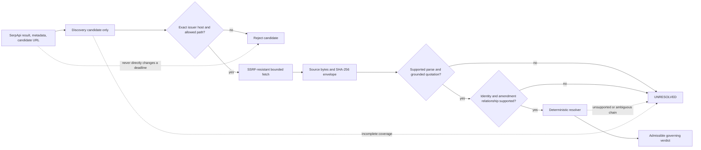

# NoticeDrift

> **The document wasn't fake. The deadline was old.**

An official notice can remain authentic even after a separate corrigendum changes its deadline. NoticeDrift uses SerpApi Google Search to discover possible amendments, then requires admissible official-source evidence and deterministic amendment resolution before supporting a governing decision.

**Search finds candidates. Evidence decides.** This Python/FastAPI application is not a notice aggregator or snippet summarizer: it checks whether a supplied deadline is supported by the admitted evidence, and returns `UNRESOLVED` when the required discovery or evidence chain is incomplete.

Start with the [local quick start](#quick-start--windows-powershell), inspect the [architecture](#architecture) and [evidence boundary](#security-and-evidence-boundary), or follow the judge path below. No credentials are needed for the synthetic demo.

## Judge quick path

The localhost homepage has four deliberately separate sections:

1. **01 / An actual government correction:** NCA-F Teaching Associates, original deadline **1 October 2026**, corrected to **26 October 2026**. This is manually reviewed context, **not** an automatically authenticated government-document resolution.
2. **02 / Recorded live-search diagnostic:** six genuine SerpApi attempts; identity and core extension completed, four other searches reached the 15-second attempt deadline. Coverage `INSUFFICIENT`, outcome `UNRESOLVED`, **zero official-source captures**. The clone includes this sanitized static summary, not the private provider archive or a fresh execution.
3. **03 / Run the complete workflow:** click **Try synthetic outdated deadline** (runs automatically), then **Analyze synthetic notice** to rerun the selected date. The `SUPERSEDED` result uses **mocked SerpApi responses and fictional `issuer.example` documents**. Open **Show synthetic machine-readable evidence** to inspect quotations, hashes and the event chain. The shared example dates do not make this the real NCA-F execution.
4. **04 / Check a real notice:** disabled without private SerpApi credentials and operator-reviewed issuer configuration. This is a separate, credit-consuming capability, not a publicly configured live service.

For a timed walkthrough, see the [2:30 demo plan](docs/submission-readiness/DEMO_PLAN.md); use the current UI's exact mode `SYNTHETIC_OFFLINE_FRESH_REQUESTED` when showing the synthetic JSON.

## The problem

An applicant may find a legitimate recruitment notice with a deadline of **1 October**, while a later corrigendum changes it to **26 October** and the original stays online. Search alone cannot establish which value governs.

## What NoticeDrift does

1. Accepts structured notice identity and a supplied value.
2. Plans bounded searches for identity, corrigenda, extensions, cancellations, and approved official-host discovery.
3. Uses SerpApi Google Search with quota accounting and query-provenance checks.
4. Treats search results as discovery leads, never governing evidence.
5. Admits documents only from operator-attested issuer hosts and approved paths.
6. Safely fetches, hashes, parses, grounds, and resolves admitted evidence.
7. Returns `SUPPORTED_BY_EVIDENCE`, `SUPERSEDED`, or fail-closed `UNRESOLVED` (with explicit `CANCELLED` and `CONFLICT` outcomes when established).

## Why SerpApi matters

SerpApi's **Google Search API** (`search.json`, `engine=google`) supplies candidate publications across notice identity, corrigenda, extensions, cancellations and official-host discovery. Those separate searches matter because the original notice can remain online while its correction appears elsewhere.

The implemented planner has an eight-call ceiling; the current NCA-F plan has six queries. Execution records requested query parameters, checks provider-reported query identity when supplied, validates result schemas, classifies timings/timeouts and reserves credits in a persistent SQLite ledger. Failed required discovery blocks the workflow before source capture; there are no automatic provider retries.

SerpApi is a discovery dependency, **not a source authenticator or verdict engine**. The recorded diagnostic demonstrates genuine provider interaction; the synthetic demo demonstrates the complete decision pipeline. Neither establishes a successfully resolved live government notice.

## Architecture

```mermaid
flowchart LR
  UI[Judge UI] --> API[FastAPI API]
  API --> Request[Structured notice request]
  Request --> Planner[Search planner]
  Planner --> Executor[Search executor]
  Executor <--> Serp[SerpApi Google Search]
  Ledger[(SQLite credit ledger)] -. accounting .-> Executor
  Executor --> Manifest[Search manifest and completeness gate]
  Manifest --> Authority[Issuer host and publication-path policy]
  Authority --> Fetch[Protected source fetch]
  Fetch --> Snapshot[(Hash-verified snapshot store)]
  Snapshot --> Parse[HTML or text-PDF parser]
  Parse --> Ground[Grounded facts and document bindings]
  Ground --> Timeline[Governance-event timeline]
  Timeline --> Verdict[Verdict and evidence presentation]
  Manifest -. incomplete discovery .-> Abstain[UNRESOLVED]
  Authority -. rejected source .-> Abstain
  Parse -. unsupported or partial source .-> Abstain
```



## Security and evidence boundary



A genuine provider response is not an authoritative document. Search completeness cannot prove every possible correction has been found; unsafe URLs, unsupported documents, unclear identity, or incomplete discovery conservatively lead to abstention.

## Demonstration modes

| Mode | What it proves | What it does **not** prove |
|---|---|---|
| **SYNTHETIC end-to-end demonstration** | Mocked SerpApi responses, fictional source documents, hashing, parsing, grounding, and a complete deterministic correction workflow. | A genuine provider response or government-source verification. |
| **Recorded genuine SerpApi diagnostic** | Six genuine provider attempts in the latest recorded run: two completed and four reached a 15-second total-attempt deadline. | A completed official-source verification: coverage was `INSUFFICIENT`, verdict `UNRESOLVED`, and no authoritative source bytes were admitted. |

The judge UI visibly separates synthetic search entries (`SYNTHETIC`) from the redacted recorded provider diagnostic. Neither search snippets nor the diagnostic directly govern a deadline.

## Quick start — Windows PowerShell

```powershell
git clone https://github.com/saikiranpulagalla/noticedrift.git
Set-Location noticedrift
py -3.11 -m venv .venv
.\.venv\Scripts\python.exe -m pip install -r requirements.txt
.\.venv\Scripts\python.exe -m uvicorn app.api.main:app --app-dir backend --host 127.0.0.1 --port 8000
```

Open <http://127.0.0.1:8000/>. The offline synthetic demonstration needs no API key. The real-check form is operator-configured only; see the [live-check runbook](docs/submission-readiness/LIVE_CHECK_RUNBOOK.md).

If another application occupies port 8000, use an available localhost port such as `--port 8765` and open that port instead; do not terminate an unrelated process. The release checker below selects an ephemeral loopback port and cleans up its own server automatically.

## Testing and release evidence

```powershell
.\.venv\Scripts\python.exe scripts\verify_v085.py
.\scripts\final_release_check.ps1 -Python .\.venv\Scripts\python.exe
```

**Offline and local verification of the repairs published in `33d91f5741be1c8b4d64f29fe64437384b6b38a1`:**

| Gate | Observed Windows result |
|---|---|
| Runtime | Python 3.11.9 |
| Full suite | **566 passed, 0 failed, 0 skipped** |
| Exact branch-aware coverage | **95.181066%** |
| Stability | **3/3 passed** |
| Focused repair regressions | 23 P0 tests and 20 CSS visibility tests; 146 combined focused checks passed |
| Dependencies and complete PowerShell checker | **PASS; checker exit 0** |
| Local HTTP smoke and child-server cleanup | **PASS** |

These results cover the current application repairs, not complete live SerpApi discovery or authenticated government-source resolution. Separate browser visual verification is **not established**. Coverage measures exercised branches, not universal semantic correctness.

The PowerShell checker defaults to the project's `.venv` Python 3.11 executable, never a global Python selected from PATH. It verifies the exact synthetic execution mode and `SYNTHETIC` search entries as well as the recorded diagnostic's conservative outcome.

## Hackathon attribution

Built for the **SerpApi India Hackathon 2026**. This repository does not independently establish the selected submission track.

- Repository: <https://github.com/saikiranpulagalla/noticedrift>
- Developed with AI-assisted coding and documentation support, including OpenAI Codex. The [disclosure worksheet](docs/submission-readiness/DISCLOSURES.md) contains participant-maintained AI-tool and pre-existing-work disclosures; it is not proof of the final submitted wording.

## Project structure

```text
backend/app/api/          FastAPI routes and local judge UI
backend/app/application/  workflow, synthetic demo, recorded diagnostic
backend/app/search/       planner, SerpApi client, manifests, budgets
backend/app/sources/      authority policy, safe fetch, snapshots, parsing
backend/app/domain/       evidence models and deterministic resolver
backend/tests/            unit, property, adversarial, judge, source tests
scripts/                  release verifier and local release checker
docs/                     architecture, repair notes, submission materials
```

## Engineering safeguards

| Safeguard | Implemented behavior |
|---|---|
| Search completeness | Provider failures, malformed data, and incomplete result sets block positive assurance. |
| Official issuer policy | Exact issuer hosts and reviewed publication paths are required for live admission. |
| Protected source fetch | URL validation, IP pinning, and bounded responses defend the source boundary. |
| Source integrity | Captured bytes are stored in hash-verified evidence envelopes; quotas preserve existing evidence. |
| Query provenance | A provider-reported executed query, when supplied, must match the requested query; mismatches are rejected. |
| Deterministic relationships | Amendments require grounded facts, identity binding, and explicit event lineage. |
| Conservative abstention | Unsupported parsing, uncertain relationships, contradictory extracted deadlines or incomplete discovery return `UNRESOLVED`; the domain also represents established `CONFLICT` and `CANCELLED` outcomes explicitly. |
| Bounded cost | Planned calls and a shared SQLite ledger constrain provider usage. |

## Limitations

- The genuine NCA-F run did not complete authoritative source verification.
- Scanned or image-only PDFs are not automatically admitted by the text parser.
- Ambiguous notice relationships, partial parsing, and scoped or conflicting amendments fail closed.
- Provider timeouts prevent complete search coverage.
- Web search cannot prove the global absence of a later correction.
- Snapshot hashes establish byte identity, not publisher signatures or protection against a local administrator replacing evidence; private storage permissions remain required.

## Further reading

- [Architecture](docs/ARCHITECTURE.md)
- [Threat model](docs/THREAT_MODEL.md)
- [Source-ingestion boundary](docs/SOURCE_INGESTION.md)
- [v0.8.5 repair notes](docs/REPAIR_V085.md)
- [Judge/demo notes](docs/JUDGE_V08.md)

## Detailed release notes and verifier history

<details>
<summary>Historical implementation notes and earlier release gates</summary>

The notes below preserve earlier release context. The current **Testing and release evidence** section above is authoritative for this published repair; historical environment statements are not current verification claims.

### v0.8.5 — Provider-provenance and platform hardening

- SerpApi search returns are invalid if a provider-reported executed query differs from the requested query; malformed/missing organic data cannot silently justify no-update assurance.
- Streaming-bound external SerpApi JSON: 2 MiB limit before decoding. Invalid individual results trigger an incomplete-search error, never false full coverage.
- Reused live API responses now report `provider_calls=0` for **new** calls and `origin_provider_calls` for the original snapshot's attempt count.
- Operator publication-path allowlisting denies encoded dot/step separators, double-encoding, and residual percent ambiguities.
- On Windows/Python 3.11, snapshots use inherited NTFS directory ACLs instead of calling unavailable `os.fchmod`; configure a **private evidence directory**. POSIX still sets 0600.
- Cancelled parsing and snapshot I/O drain the already-started bounded worker rather than leaving unaccounted threads.
- Snapshot archives retain every distinct timestamped capture for replay but refuse new writes after 1024 stored captures or 200 MB of envelopes (defaults). No automatic eviction.
- Offline release gate includes both v0.8.4 audit suites and new provider/retention cross-fix tests. The earlier Windows baseline was 521 tests, 95.130537% exact branch-aware coverage and 3/3 stability runs; the newer repair verification is recorded above. A complete SerpApi-to-attested-source run remains **NOT VERIFIED**.

Run `.\.venv\Scripts\python.exe scripts\verify_v085.py`. See `docs/REPAIR_V085.md` for exact contracts and remaining risks.
Windows repair details and the current local-validation limitations are in
`docs/REPAIR_WINDOWS_V085.md`.

## v0.8.4 — Final adversarial repair (offline-verified only)

**What is new:** SerpApi organic-list truncation now fails closed; invalid original URLs are rejected *before* any paid request; request-body sizes are enforced while streaming; historical checks are UTC-invariant; provider failures preserve attempted-call counts; source snapshot I/O failures abstain; HTML/PDF parsing and snapshot storage run outside the server event loop; uncertain low-signal source overflow blocks positive assurance; and operator issuer attestations support canonical issuer names, annual review and explicit publication-path policies. Official search result ranking remains *discovery*, never source authority.

**Important migration for LIVE mode:** issuer-attestation entries must now include `canonical_issuer_name` and `publication_path_prefixes` (operator-reviewed publisher-controlled paths). Without these, the app refuses live readiness. Example manifest and security limitations: `docs/REPAIR_V084.md`.

**Historical release evidence:** Run `.\.venv\Scripts\python.exe scripts\verify_v085.py` for the current gate. It compiles, checks the complete inherited and Round 4/5 adversarial suites with **exact** ≥95% branch-aware coverage, checks the synthetic demo, and repeats tests three times. CI is configured for Linux Python 3.11/3.13 and Windows Python 3.11; configuration alone is not evidence of a passing CI job.

**Unverified:** a complete SerpApi-to-attested-source run, real NCA-F corrigendum source-byte capture and automatic governing proof, browser live E2E, and production-grade resilience under multi-worker traffic. A genuine provider diagnostic exists, but it is incomplete and remains `UNRESOLVED`.

### Run the judge interface (no API key, no external services)

Python **3.11–3.13**:

```powershell
.\.venv\Scripts\python.exe -m pip install -r requirements.txt
.\.venv\Scripts\python.exe -m uvicorn app.api.main:app --app-dir backend --host 127.0.0.1 --port 8000
```

Open **http://127.0.0.1:8000/** in your browser. The UI works in unconfigured mode.

### What to click in under three minutes

1. Show the **real NCA-F reference** panel: October 1 → October 26, 2026. Open the official corrigendum PDF or the government page. **This is reference material reviewed from public web sources, NOT an application-captured live SerpApi run.**
2. Mention the qualification correction (Physiology → Psychology for one post). It is shown transparently, **outside the automated deadline-only resolver**.
3. Show **Recorded live-search diagnostic**: six genuine provider attempts, two completions, four bounded timeouts, `INSUFFICIENT` coverage and `UNRESOLVED`. It has **zero** official-source captures.
4. Click **Try synthetic outdated deadline** under *Run the complete workflow* → `SUPERSEDED` from two **synthetic** captured source documents and mock search entries.
5. Click **Show synthetic machine-readable evidence** → exact quotations, source hashes, bounded mock search manifest and decision provenance.
6. Click **Try synthetic revised deadline** → `SUPPORTED_BY_EVIDENCE` (not absolute verified-current).

**Demo honesty:** The code executes the real search planner/executor, source capture, HTML parser, grounding, issuer-host check, governance event builder and resolver. Only the external search transport, issuer domain and document bytes are **fictional**. No live SerpApi searches are made by the offline demo. Its per-search mode is explicitly `SYNTHETIC`.

### Real live-check form (operator-configured only)

The interface now exposes **04 / Check a real notice**. It is disabled unless
`SERPAPI_API_KEY` and `NOTICEDRIFT_ISSUER_ATTESTATIONS` are supplied by the
operator. The issuer name, reference and deadline are entered in the form; the
backend **never** accepts an authority attestation from the user. Live checks
may consume actual SerpApi credits; the monthly SQLite ledger and bounded
API admissions apply. The real NCA-F source panel is separately labeled as
manual reference material and does *not* claim a live SerpApi run.

The parser conservatively abstains on hidden/uncertain HTML, low-contrast or
sub-legible PDF text, opaque backgrounds, unsafe search-identity rewriting, or
incomplete official evidence. Static parsing cannot prove all browser/PDF
rendering conditions; unsupported styles remain `UNRESOLVED`.

### Verify

```powershell
.\.venv\Scripts\python.exe scripts\verify_v085.py
```

On Windows, the one-command local release check uses an ephemeral
`127.0.0.1` port, checks dependencies, runs the verifier, validates the HTTP
demo contracts, and stops only the server it started:

```powershell
.\scripts\final_release_check.ps1 -Python .\.venv\Scripts\python.exe
```

The verifier compiles the code, runs the full suite with **exact** ≥95% branch-aware coverage, exercises the E2E demo and repeats the complete test suite three times. No live SerpApi credentials are used. The current published repair passed the complete gate; see the verification table above.

### Routes

| Route | What it does |
|---|---|
| `GET /` | Judge interface, offline-capable |
| `GET /api/reference-case` | Publicly reviewed NCA-F facts with explicit provenance limitations |
| `GET /api/live-search-diagnostic` | Sanitized static summary of the genuine, incomplete provider run; not source evidence |
| `POST /api/demo/check` | Synthetic E2E check; body `{"supplied_deadline":"2026-10-01"}` |
| `GET /health` | App readiness and config flag |
| `GET /api/capabilities` | Supported scope and live availability |
| `POST /api/check` | **Real live** bounded search check; 503 unless operator config is available |

For operator-only live configuration, see `docs/END_TO_END_V07.md`. In particular, the SerpApi API key and issuer attestations **must not be sent to untrusted clients**. The optional SQLite credit budget is shared across workers if configured correctly.

### Release and submission readiness

See `docs/WINDOWS_RELEASE_VERIFICATION.md` for the actual Windows verification
record and PowerShell commands for a normal Windows environment. The bounded
operator live-check procedure, demo timeline, submission description, checklist,
clean-install plan, and honest limitations are in `docs/submission-readiness/`.
This checkout records a genuine but incomplete SerpApi search diagnostic; it does
not claim a credentialed SerpApi-to-official-source result.

### Supported scope

Explicit structured English notices containing deadlines, deterministic *old → new* extensions and full cancellations; static HTML and supported text PDFs. Unknown identity, ambiguous context, hidden source content, partial PDFs, scoped corrections, unsupported amendment types and incomplete discovery must abstain. The live hero notice is **not yet validated through actual source-byte ingestion with a real SerpApi response**. The real NCA-F page also contains a qualification change outside deadline-only support.

Read `docs/JUDGE_V08.md` for source provenance, reproducibility, and what remains before a production/live demo.

See `docs/REPAIR_V081.md` for the reproduced v0.8 defects, repaired contracts and remaining live-release blockers.

### v0.8.3: real-source discovery improvements (live gate remains open)

The `notice_title` input adds one bounded official-host title/corrigendum search without changing the 4 exact-reference core searches or the hard 8-call ceiling. Search hits remain untrusted; different notice numbers are not automatically merged. The live form now uses the same `ncaf` issuer ID, reference and original PDF URL as the operator command, and shows SerpApi search provenance separately from source evidence. For private API-key setup, honest live attempt, and final submission gates, see **[docs/RELEASE_GATE_V083.md](docs/RELEASE_GATE_V083.md)**.

Use `.\.venv\Scripts\python.exe scripts\verify_v085.py` for the offline release gate. A complete real SerpApi-to-authenticated-source check remains unverified.

### v0.8.2 — Real-world compatibility and verification kit

`.\.venv\Scripts\python.exe scripts\real_case_probe.py` checks the **actual published NCA-F wording** as
manually reviewed source excerpts (not source-byte evidence).
`.\.venv\Scripts\python.exe scripts\live_ncaf_check.py` shows exactly which bounded SerpApi
queries will run, **without making any requests**. With explicit `--execute`,
operator-supplied credentials and a manually attested issuer host, it can
run a genuine source check. No key or issuer manifest is bundled.

See [`docs/REAL_CASE_GATE_V082.md`](docs/REAL_CASE_GATE_V082.md) for source
URLs, the exact reference mismatch, scanned-PDF limitation, operator steps
and promotion gates. The original v0.8.1 safety tests remain unchanged.

The historical gate was `scripts/verify_v082.py`; use `scripts/verify_v085.py` for the current release.
**No live SerpApi-powered NCA-F verdict has been verified in this release.**

</details>
